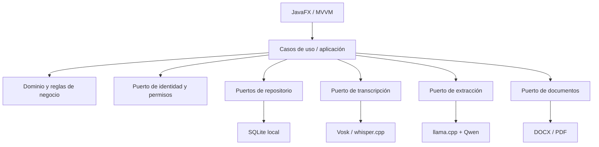

# Voxora — Especificación y plan maestro del software

**Versión del documento:** 1.1 (diseño, no implementación)
**Producto:** Voxora (nombre de trabajo; comprobar marcas y usos existentes antes de publicar)
**Alcance de la versión 1.0:** aplicación de escritorio multiusuario **en una sola PC**.
**Estado:** decisiones acordadas + propuestas explícitamente pendientes.

## 1. Visión

Voxora permite a un supervisor crear y asignar incidencias técnicas; a un técnico atenderlas y narrar libremente (voz) lo que encontró y resolvió; y a un supervisor revisar y aprobar el reporte formal. La transcripción y extracción de información se realizan localmente, sin depender de una API de IA en la nube. Los reportes se exportan a PDF/DOCX y quedan registrados con trazabilidad.

**No es solamente un dictador de voz ni un gestor de tickets:** integra asignación, seguimiento, evidencia de atención, IA local, revisión y documentación.

### Alcance / exclusiones
- **Incluido:** una computadora Windows 10/11 x64, cuentas internas de Voxora, SQLite local, funcionamiento offline después de instalar, tablero visual Kanban, IA local, documentos, auditoría, backups.
- **No incluido en v1.0:** sincronización por IP/LAN, servidor central, app web o móvil, multi-PC simultáneo, nube, entrenamiento de modelos propios, firmas digitales certificadas.
- **Meta de hardware:** 4 GB de RAM física; **pendiente de validación** mediante benchmarks y prueba en hardware real.
- **Duración objetivo de narración:** 1 a 3 minutos (se probará especialmente 3 minutos).

## 2. Decisiones tecnológicas

| Componente | Elección | Estado |
|---|---|---|
| Lenguaje | Java 21 LTS | Acordado |
| UI | JavaFX con MVVM | Acordado |
| Arquitectura | Monolito modular + puertos/adaptadores (hexagonal) | Acordado |
| Build | Maven | Propuesto |
| Persistencia | SQLite + JDBC Xerial | Acordado |
| Reconocimiento de voz | Vosk Small Spanish (`vosk-model-small-es-0.42`) | Candidato a evaluar |
| Alternativa STT | whisper.cpp con Whisper Tiny y opcionalmente Base | Candidato comparativo |
| Extracción de campos | Qwen3 0.6B GGUF Q4 | Candidato a evaluar |
| Inferencia LLM | llama.cpp, CPU local, solo loopback | Propuesto |
| JSON | Jackson | Propuesto |
| DOCX | Apache POI | Propuesto |
| PDF | OpenPDF o PDFBox | Pendiente de elección |
| Contraseñas | Argon2id con sal aleatoria por usuario | Requisito |
| Pruebas | JUnit 5, pruebas de integración y benchmarks | Propuesto |
| Empaquetado | jpackage con runtime incluido | Propuesto |
| Control de versiones | Git + GitHub; versiones/releases | Acordado |

> Las versiones exactas, hashes SHA-256 y licencias de motores y modelos se fijarán después de los benchmarks. El nombre Voxora ya tiene usos públicos similares: verificar riesgos de confusión y marcas.

## 3. Arquitectura



**Módulos funcionales:** `bootstrap`, `identity`, `incidents`, `attentions`, `voice`, `intelligence`, `reports`, `audit`, `settings` y `dashboard`. Separar dominio, aplicación, infraestructura y presentación por característica. No poner consultas SQL, lógica de permisos o prompts de IA en controladores JavaFX. Procesar audio e IA en tareas asíncronas.

### Una sola PC
Los supervisores y técnicos se turnan en la **misma instalación**: supervisor inicia sesión → crea y asigna → cierra sesión → técnico inicia sesión → atiende y documenta → supervisor vuelve y revisa. Todos consultan la misma SQLite; no hay comunicación de red entre equipos.

**Ruta inicial sugerida:** `%LOCALAPPDATA%\Voxora\data\voxora.db` (común a las cuentas *de Voxora* dentro de un mismo perfil de Windows). Si se usan diferentes **cuentas de Windows**, `LOCALAPPDATA` no es compartido; decidir una ubicación común protegida y ACL apropiadas antes de habilitar ese escenario.

## 4. Roles y autorización

| Operación | Superadministrador (soporte) | Administrador (supervisor) | Usuario (técnico) |
|---|---|---|---|
| Configuración global, modelos y backups | Sí | No | No |
| Crear/modificar/desactivar cuentas | Sí | Técnicos, según permiso | No |
| Configurar permisos/vistas | Sí | No por defecto | No |
| Crear incidencias | Sí | Sí | No |
| Asignar/reasignar incidencias | Sí | Sí | No |
| Consultar todas las incidencias | Sí | Sí | No |
| Consultar incidencias propias | Sí | Sí | Sí |
| Iniciar atención y dictar reporte | Sí | Sí | Solo asignadas |
| Corregir borradores propios | Sí | Sí | Sí |
| Aprobar/devolver reportes | Sí | Sí | No |
| Ver auditoría | Completa | Limitada | No |

**Permisos granulares propuestos:** `incidents.create`, `incidents.assign`, `incidents.view_all`, `incidents.view_assigned`, `attentions.write_assigned`, `reports.submit`, `reports.approve`, `users.manage_technicians`, `settings.manage`, `audit.view`. Las **vistas visibles** se derivan de los permisos, pero cada caso de uso verifica autorización nuevamente; ocultar botones no basta. Evitar autoelevación y mantener permisos críticos del superadmin no delegables en v1.0.

### Sesiones
- Inactividad predeterminada: **15 minutos**, configurable por superadmin entre 5 y 30 minutos.
- Advertencia al minuto 14; bloqueo/cierre de sesión al minuto 15; nuevo login obligatorio.
- Guardar borradores antes del bloqueo; no perder grabaciones ni resultados parciales.
- Si hay grabación/procesamiento activo, diseñar transición segura: preservar archivo y estado, bloquear acceso y permitir recuperación tras autenticación; no considerar actividad automática de IA como actividad humana.
- Registrar inicio/cierre, bloqueo por inactividad y cambios sensibles en auditoría. Evaluar límite de intentos fallidos.

## 5. Ciclo de vida de la incidencia

**Estados acordados para v1.0:** `PENDIENTE` → `ASIGNADO` → `EN_PROCESO` → `EN_REVISION` → `COMPLETADO`.

| Estado | Significado | Responsable de transición |
|---|---|---|
| PENDIENTE | Creada, sin técnico asignado | Supervisor |
| ASIGNADO | Tiene técnico responsable | Supervisor |
| EN_PROCESO | Técnico atiende y prepara documentación | Técnico asignado |
| EN_REVISION | Técnico envió reporte | Técnico asignado |
| COMPLETADO | Supervisor aprobó reporte | Supervisor |

**Devolución:** `EN_REVISION` → `EN_PROCESO`, obligando a guardar motivo. **Pendiente de especificar:** cancelación, bloqueo, reapertura y tratamiento de incidencias irresolubles. No permitir `COMPLETADO` solo porque la IA produjo un documento.

**Metodología:** desarrollo del producto organizado con Scrum (backlog, sprints, revisiones); gestión diaria de incidencias visualizada con **tablero Kanban**. No son conceptos equivalentes.

## 6. Requisitos funcionales

| ID | Requisito | Prioridad |
|---|---|---|
| RF-01 | Instalación/primer arranque y creación segura del primer superadmin | Alta |
| RF-02 | Login, logout, bloqueo por inactividad | Alta |
| RF-03 | Alta, edición, desactivación y asignación de roles | Alta |
| RF-04 | Permisos granulares y visibilidad de pantallas por permiso | Alta |
| RF-05 | Crear/editar incidencias con prioridad, ubicación y descripción | Alta |
| RF-06 | Asignar/reasignar técnico con historial | Alta |
| RF-07 | Listar, filtrar y consultar incidencias según permisos | Alta |
| RF-08 | Transiciones de estado validadas y trazadas | Alta |
| RF-09 | Dashboard y tablero Kanban | Alta |
| RF-10 | Grabar audio de narración libre de 1–3 min | Alta |
| RF-11 | Transcribir audio localmente y permitir corrección | Alta |
| RF-12 | Extraer campos estructurados mediante IA local | Alta |
| RF-13 | Validar datos, señalar ausencias y evitar inventar información | Alta |
| RF-14 | Editar y guardar borrador automáticamente | Alta |
| RF-15 | Enviar reporte a revisión, aprobar/devolver con observación | Alta |
| RF-16 | Exportar PDF/DOCX y guardar versión/historial | Alta |
| RF-17 | Auditar acciones, responsables y cambios de estado | Alta |
| RF-18 | Respaldar/restaurar SQLite de forma consistente | Alta |
| RF-19 | Configurar modelos locales y rutas | Media |
| RF-20 | Estadísticas por estado, prioridad, técnico y periodo | Media |
| RF-21 | Configurar tiempo de inactividad (5–30 min) | Alta |
| RF-22 | Recuperar trabajos tras cierre/fallo del proceso de IA | Alta |

## 7. Requisitos no funcionales

| ID | Requisito | Verificación |
|---|---|---|
| RNF-01 | Windows 10/11 x64 | Instalación y prueba en ambos |
| RNF-02 | Objetivo de 4 GB RAM | Benchmark en VM + equipo físico |
| RNF-03 | Funciones esenciales offline | Red desconectada en ejecución |
| RNF-04 | Persistencia íntegra tras reinicio | Pruebas de reinicio y recuperación |
| RNF-05 | Argon2id, autorización por operación | Pruebas de seguridad |
| RNF-06 | UI no bloqueada durante IA | Prueba de interacción mientras procesa |
| RNF-07 | Build reproducible desde GitHub | CI Windows + clon limpio |
| RNF-08 | Instalador con runtime | Instalación sin JDK previo |
| RNF-09 | SQLite con claves foráneas/migraciones/transacciones | Pruebas de integridad |
| RNF-10 | Backups verificables | Restauración y comprobación de datos |
| RNF-11 | Privacidad y archivos protegidos | Revisión de permisos/logs |
| RNF-12 | Trazabilidad de modificaciones | Pruebas de auditoría |
| RNF-13 | Cierre/bloqueo a 15 min con aviso y sin pérdida | Prueba con cronómetro |
| RNF-14 | Calidad de transcripción y extracción | Dataset etiquetado y métricas |

Los umbrales cuantitativos de WER, precisión y tiempo son **criterios de aceptación por fijar antes del benchmark**, no resultados garantizados.

## 8. Casos de uso

- **UC-01** Instalar e inicializar superadministrador.
- **UC-02** Iniciar/cerrar sesión; bloqueo por inactividad.
- **UC-03** Administrar usuarios, roles y permisos.
- **UC-04** Supervisor crea incidencia y asigna técnico.
- **UC-05** Técnico consulta sus incidencias e inicia atención.
- **UC-06** Técnico narra, transcribe, corrige y genera borrador con IA.
- **UC-07** Técnico envía reporte; supervisor aprueba o devuelve.
- **UC-08** Exportar PDF/DOCX y consultar versiones.
- **UC-09** Consultar tablero, indicadores e historial.
- **UC-10** Superadmin respalda/restaura datos y configura modelos.

**UC-06, flujo principal:** login → incidencia asignada → iniciar atención → grabar → guardar audio → transcribir → corregir texto → extraer JSON → validar → editar borrador → guardar → enviar a revisión. **Alternativas:** micrófono ausente, STT falla, LLM no responde, JSON inválido, datos insuficientes, sesión expira, aplicación se cierra; en todos los casos preservar lo ya capturado.

## 9. Pantallas

1. Asistente de primer arranque y superadmin (solo instalación nueva).
2. Login y recuperación administrativa de acceso (mecanismo por definir).
3. Dashboard por rol: contadores y tareas propias.
4. Tablero Kanban con columnas de estados y filtros.
5. Lista/detalle de incidencia: datos, prioridad, asignado, historial.
6. Formulario de creación/asignación (supervisor).
7. Atención por voz: grabación, transcripción editable, extracción, vista previa.
8. Revisión/aprobación/devolución de reporte.
9. Historial y exportación PDF/DOCX.
10. Usuarios, roles y permisos (según autorización).
11. Configuración de IA, almacenamiento, backup y sesión.
12. Auditoría y estadísticas (según autorización).

## 10. Modelo de datos propuesto (a normalizar antes de implementar)

| Entidad | Campos esenciales | Relaciones |
|---|---|---|
| `users` | id, username UNIQUE, password_hash, active, created_at | roles, incidencias, atenciones, revisiones |
| `roles` | id, code UNIQUE, name | N:M con users |
| `permissions` | id, code UNIQUE | N:M con roles |
| `user_roles` | user_id, role_id | FK compuesta |
| `role_permissions` | role_id, permission_id | FK compuesta |
| `incidents` | id, code UNIQUE, title, description, priority, location, status, created_by, assigned_to NULL, created_at, updated_at | usuarios; 1:N atenciones |
| `incident_status_history` | id, incident_id, from_status, to_status, changed_by, reason, at | incidente y usuario |
| `incident_assignments` | id, incident_id, technician_id, assigned_by, assigned_at, unassigned_at | historial de asignaciones |
| `attentions` | id, incident_id, technician_id, started_at, finished_at, outcome | incidente; 1:N reportes |
| `recordings` | id, attention_id, file_path, duration_ms, retained_until | atención |
| `transcriptions` | id, attention_id, raw_text, corrected_text, engine_version | atención |
| `reports` | id, attention_id, status, current_version, submitted_at, reviewed_by, reviewed_at | atención; versiones |
| `report_versions` | id, report_id, version, structured_json, edited_by, created_at | reporte |
| `report_reviews` | id, report_id, reviewer_id, decision, comments, at | reporte |
| `audit_logs` | id, actor_id, action, entity_type, entity_id, at, metadata_minimal | usuario |
| `app_settings` | key, value | configuración |
| `schema_migrations` | version, applied_at, checksum | migraciones |

**Restricciones:** FK activas (`PRAGMA foreign_keys=ON` en cada conexión), transacciones para cambio de estado+auditoría, índices en asignado/estado/fecha, `CHECK` para estados y prioridades, UNIQUE en nombres y códigos, no borrar usuarios con historial (desactivar), validar que técnico asignado esté activo y autorizado, revisión solo por supervisor autorizado, no permitir aprobar un reporte propio si se decide separación de funciones. Los archivos de audio/documentos se referencian por rutas seguras; definir limpieza y copias.

**Aclaración:** la relación `attentions` → `reports` permite más de un reporte si el negocio lo necesita; decidir si habrá exactamente uno por atención con múltiples versiones, opción más simple para v1.0.

## 11. Seguridad, privacidad y respaldo

- Superadmin creado en primera ejecución; sin contraseña predeterminada.
- Hash Argon2id y contraseñas nunca en logs ni GitHub.
- Verificación de autorización en servicios/casos de uso.
- Cierre por inactividad, bloqueo y auditoría; guardar borradores antes de bloquear.
- Restricciones de permisos del sistema de archivos y separación de datos respecto al instalador.
- Motor de IA limitado a `127.0.0.1`; no abrir puertos en LAN.
- Datos ficticios/anonimizados en pruebas; no subir audios ni reportes privados.
- Backup SQLite consistente (API backup o `VACUUM INTO` según diseño); probar restauración.
- Política pendiente: conservar/eliminar audio original, tiempos de retención, recuperación de credenciales, cifrado en reposo.

## 12. Extracción de IA y generación documental

Entrada: narración libre del técnico. Primero STT produce texto editable. Después un extractor local obtiene un JSON validable:

```json
{
  "area": null,
  "equipo": null,
  "problema": null,
  "diagnostico": null,
  "acciones": [],
  "resultado": null,
  "estado_tecnico": "NO_ESPECIFICADO",
  "observaciones": null
}
```

**Reglas:** `null` cuando no se mencione; no inventar causas, repuestos ni pruebas; conservar orden de acciones; técnico revisa antes de enviar; supervisor aprueba. La **situación técnica** del equipo no debe confundirse con el **estado administrativo** del ticket. Java genera PDF/DOCX mediante plantillas, no el LLM directamente.

## 13. Repositorio GitHub propuesto

```text
voxora-technical-reports/
├── README.md
├── LICENSE
├── .gitignore
├── pom.xml
├── docs/
│   ├── VOXORA_ESPECIFICACION_SOFTWARE.md
│   ├── VOXORA_PLAN_PRUEBAS_VM.md
│   ├── architecture.md
│   ├── security.md
│   └── installation.md
├── scripts/
│   ├── setup.ps1
│   ├── download-models.ps1
│   ├── build.ps1
│   └── package.ps1
├── src/main/java/com/tuorganizacion/voxora/
│   ├── bootstrap/ ├── identity/ ├── incidents/
│   ├── attentions/ ├── voice/ ├── intelligence/
│   ├── reports/ ├── dashboard/ ├── audit/ └── settings/
├── src/main/resources/{db/migration,fxml,templates}/
├── src/test/
└── .github/workflows/
```

El identificador de paquete es ilustrativo. No incluir `voxora.db`, contraseñas, reportes reales ni modelos sin revisar licencias. Fijar versiones/hashes de binarios y modelos. Distribuir `.exe`/`.msi` con `jpackage` y runtime Java incluido. GitHub Releases con changelog, instalador y hashes.

## 14. Plan Scrum de implementación (propuesta)

- **Sprint 0:** backlog, historias de usuario, reglas de negocio, prototipos, benchmarks de IA y definición de criterios de aceptación.
- **Sprint 1:** estructura Maven, SQLite/migraciones, bootstrap superadmin, login y permisos.
- **Sprint 2:** incidentes, asignación, estados, historial y Kanban.
- **Sprint 3:** captura de audio, transcripción, corrección y persistencia de borradores.
- **Sprint 4:** extracción IA, validación JSON, plantillas y reportes.
- **Sprint 5:** revisión/aprobación, exportación, auditoría, respaldos y cierre por inactividad.
- **Sprint 6:** pruebas integrales, seguridad, rendimiento 4 GB, instalador, documentación y release.

Los sprints son una **secuencia orientativa**, no fechas prometidas. Mantener un backlog y criterios de terminado: código revisado, pruebas, documentación, permisos y recuperación de errores.

## 15. Pendientes de decisión

1. Campos obligatorios, prioridades y códigos de ticket.
2. Plantilla exacta del reporte, firmas y anexos.
3. Reglas de cancelación, reapertura y bloqueo de incidencias.
4. Quién puede reasignar, reabrir o corregir reportes aprobados.
5. Política de audios, recuperación de contraseñas y cifrado de archivos.
6. Definir un reporte por atención con múltiples versiones o varios reportes.
7. Ubicación de datos si se usarán distintas cuentas de Windows.
8. Elección definitiva PDF, migrador, librerías y versiones.
9. Aprobación de modelos tras resultados medidos en VM y PC física.
10. Revisión de disponibilidad del nombre Voxora, licencias y publicación.

**Documento complementario:** `VOXORA_PLAN_PRUEBAS_VM.md`.
